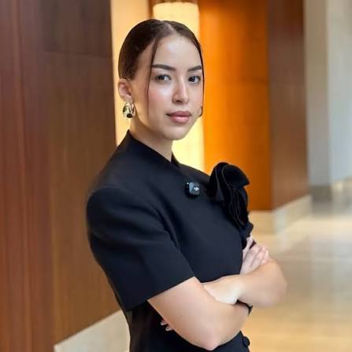
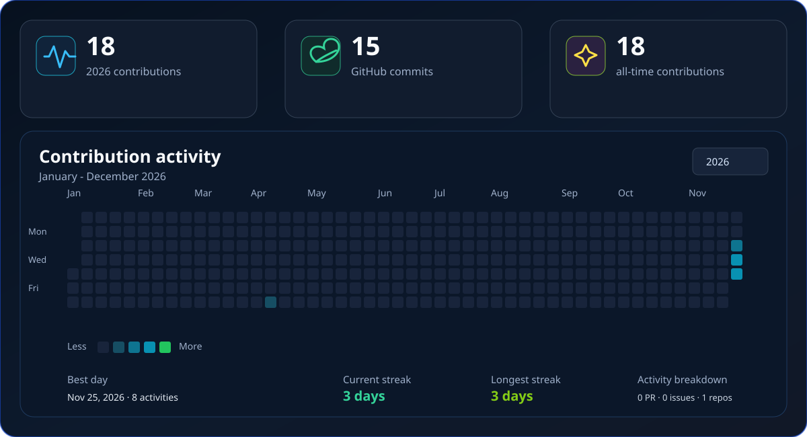

# KHADIJA CHAHMOUD
### Content Creation · Social Media Management · Creative Storytelling

  
  
  

  <strong>Real, raw, & human content for your brand.</strong>

  

  <a href="https://www.instagram.com/khadija.chahmoud/">Instagram</a> ·
  <a href="https://khadijachahmoud.github.io/">Website</a> ·
  <a href="https://github.com/KhadijaChahmoud">GitHub</a>

---

## ✨ Welcome to my creative world

I'm Khadija Chahmoud, a content creator and social media manager with a passion for storytelling, creativity, and human connection.

I believe that every brand has a story worth telling, every business has a personality worth discovering, and every meaningful connection starts with authenticity.

My focus is content creation and social media management, bringing together creativity, communication, and human storytelling to help brands express who they really are.

I believe content should do more than fill a social media feed.

It should communicate a feeling, create recognition, build trust, and give people a reason to connect with a brand.

**Real stories. Genuine connections. Meaningful content.**

---

## 🌍 My journey

Returning from Dubai to Morocco gave me an opportunity to reconnect with my roots and explore a new professional direction.

I wanted to bring my ambitions closer to home and work with people from my own country.

I believe Morocco has incredible creative potential, talented people, ambitious entrepreneurs, and businesses with stories waiting to be shared.

My vision is to connect creativity, people, and opportunities across different markets, with a presence between:

**Dubai, United Arab Emirates 🇦🇪**

**Casablanca, Morocco 🇲🇦**

Different perspectives, connected by one creative ambition.

---

## 🎬 What I do

My professional focus is built around two main areas.

### 01 — Content Creation

Creating authentic content that communicates a brand's identity and connects with its audience.

- Creative content concepts
- Brand storytelling
- Visual communication
- Content planning
- Digital brand presence

### 02 — Social Media Management

Helping brands develop a consistent and recognizable presence across social media.

- Social media content planning
- Brand communication
- Content organization
- Audience engagement strategy
- Digital presence development

*Specific services and project requirements are discussed individually.*

---

## 💡 My creative philosophy

I believe the strongest brands aren't necessarily the loudest.

They're the ones people remember.

The ones that communicate honestly, understand their audience, and create experiences that feel human.

My approach is guided by five principles:

| Principle | What it means |
|---|---|
| Authenticity | Be real, not artificial |
| Creativity | Give every idea room to grow |
| Connection | Put people before numbers |
| Consistency | Build recognition over time |
| Purpose | Create content with meaning |

**I don't believe in creating content just to post something. I believe in creating content with a reason to exist.**

---

## 🤝 Let's create something meaningful

Whether you're building a new brand, developing an existing business, or looking for a more authentic way to communicate with your audience, I'd love to discover what we could create together.

I believe the best collaborations begin with a conversation, an exchange of ideas, and a shared desire to create something valuable.

Let's turn ideas into stories and stories into meaningful connections.

---

## 📍 Based between two worlds

🇦🇪 Dubai, United Arab Emirates

A place for international perspectives, creativity, ambition, and new opportunities.

🇲🇦 Casablanca, Morocco

A connection to home, Moroccan talent, local businesses, and creative opportunities.

---

## 📊 GitHub Contribution Activity

  

## 📲 Connect with me

  
  

  <strong>Have an idea? Let's talk.</strong>

  Dubai 🇦🇪 · Casablanca 🇲🇦

---

  <em>Real, raw, & human.</em>
   
  <strong>© Khadija Chahmoud. All rights reserved.</strong>

## Installable app and offline use

On supported browsers, choose **Install this app** in Settings or use the
browser's **Add to Home Screen** option. After the first online visit, the
service worker caches the app shell and static assets; previously opened pages
can then load offline. Music selected in the player is stored privately in
that site's IndexedDB on the current device. Browsers with the File System
Access API use its audio picker; other browsers keep the standard file picker.
Push notifications need a backend and are not enabled yet.

## Family creative spaces

- [Creative Corner](https://khadijadaughter.github.io/) — example prompts for
  stories, art, and imaginative projects.
- [Curiosity Lab](https://khadijason.github.io/) — example prompts for
  building, puzzles, and new discoveries.

These are family-supported pages with parent-reviewed updates.

<!-- Account verification: KhadijaChahmoud -->
